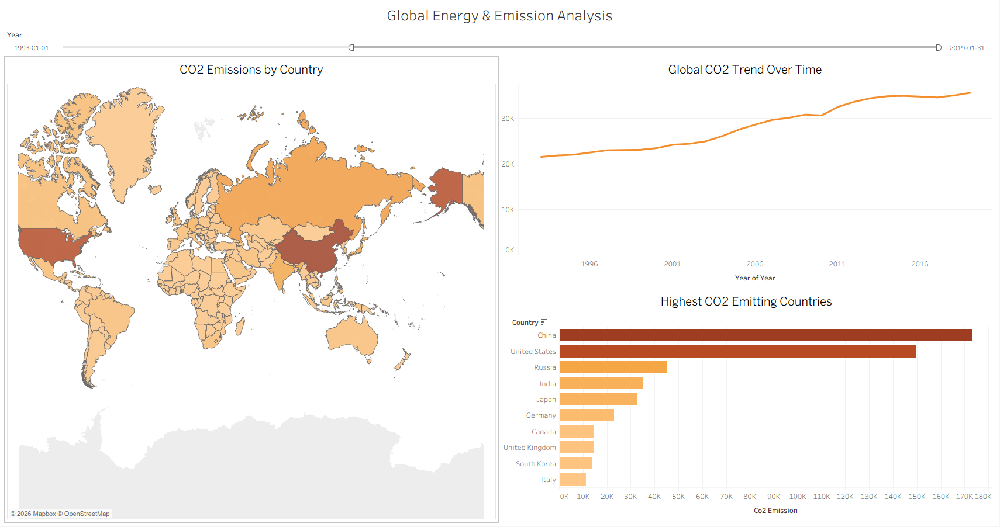
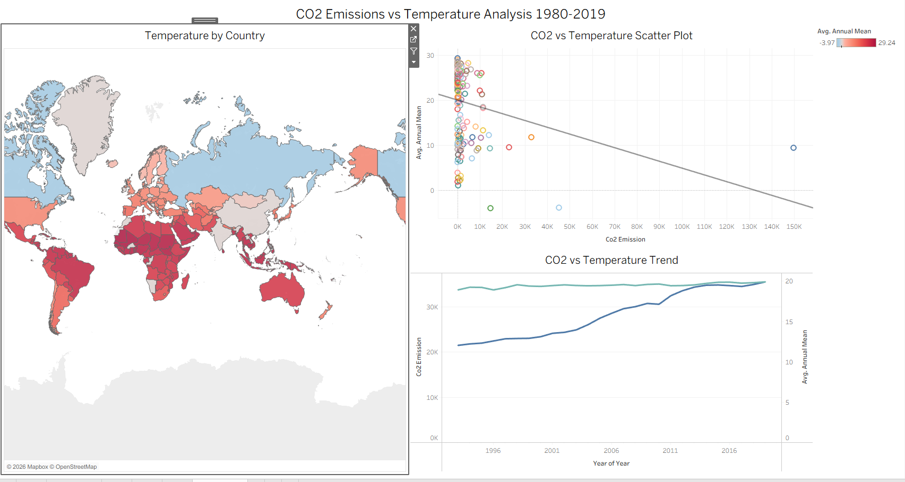
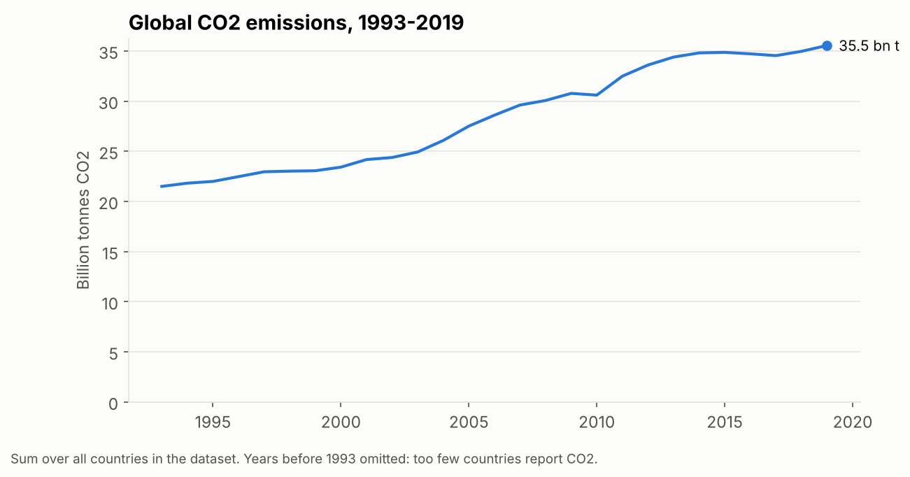
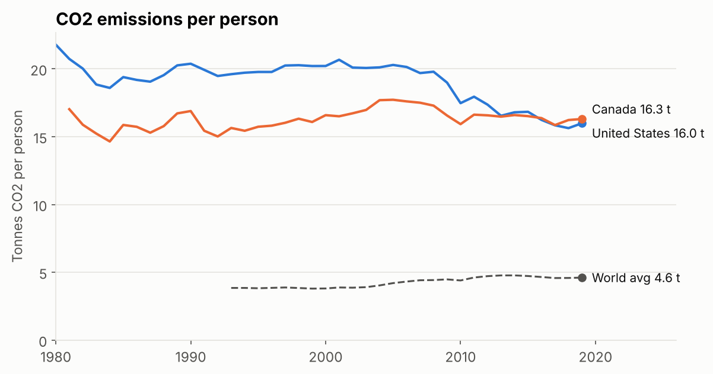
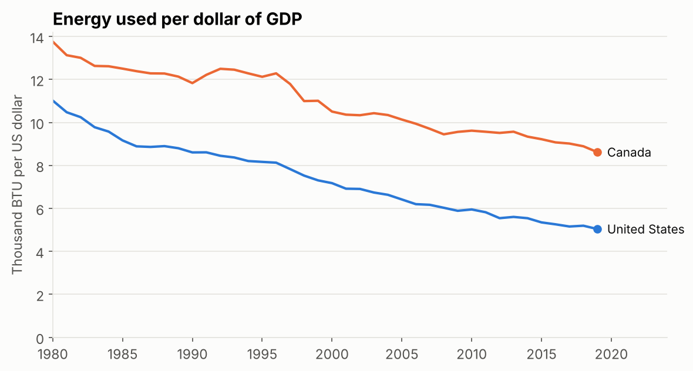
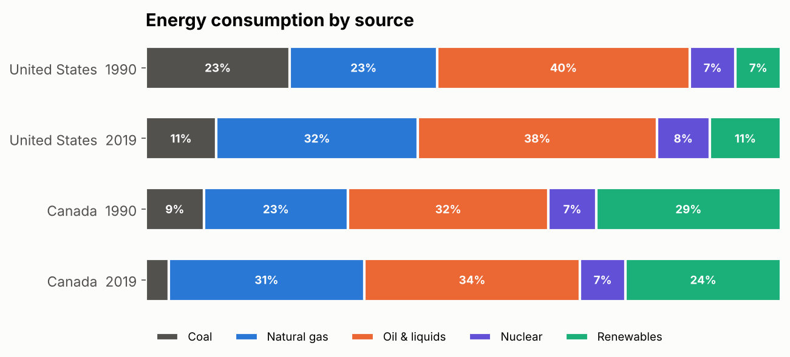
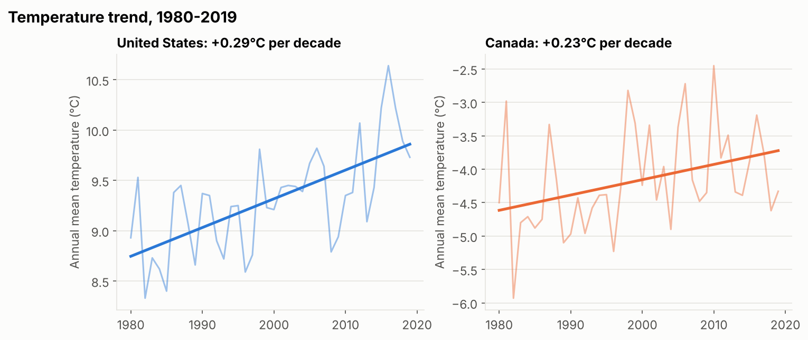
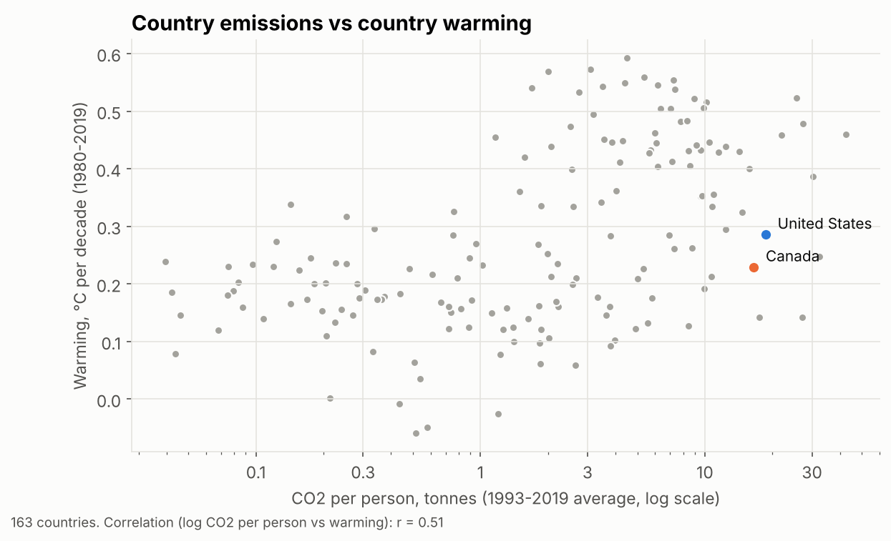

# Global Energy & CO2 Emissions Analysis
### Analyzing the Relationship Between Energy Consumption, CO2 Emissions and Temperature Change (1980-2019)

---

## 📌 Project Overview
This project investigates whether rising global energy consumption 
and CO2 emissions are linked to increasing temperatures across 
about 200 countries over 40 years (1980-2019).

The analysis focuses specifically on the United States and Canada 
as two of the world's largest energy consumers and CO2 emitters, 
while providing a global overview for context.

---

## 🛠️ Tools Used
| Tool | Purpose |
|---|---|
| Python (Pandas, NumPy) | Data cleaning, merging and analysis |
| Matplotlib | Charts |
| Jupyter Notebook | Analysis environment |
| Tableau Public | Interactive dashboards |
| GitHub | Version control and sharing |

---

## 📂 Project Structure
```
Energy/
│
├── ENERGY.ipynb                 # 1. Energy data cleaning
├── TEMPERATURE.ipynb            # 2. Temperature data cleaning
├── MERGED_DATASET.ipynb         # 3. Merge and data-quality checks
├── ANALYSIS.ipynb               # 4. Analysis and charts (US & Canada focus)
│
├── data/
│   ├── energy.csv                   # Raw energy dataset
│   ├── combined_temperature.csv     # Raw temperature dataset
│   ├── energy_cleaned.csv           # Output of ENERGY.ipynb
│   ├── cleaned_temperature.csv      # Output of TEMPERATURE.ipynb
│   ├── energy_breakdown_final.csv   # Output of MERGED_DATASET.ipynb (all energy types)
│   └── merged_final.csv             # Output of MERGED_DATASET.ipynb (energy + temperature)
│
├── images/                      # Charts saved by ANALYSIS.ipynb
└── requirements.txt
```

---

## 📊 Datasets
**1. Global Energy Dataset**
- Source: U.S. Energy Information Administration (EIA), via Kaggle
- Rows: 55,440 (raw) → 41,920 (cleaned)
- Countries: 230 (raw, plus a World aggregate) → 202 in the final merged dataset
- Years: 1980 - 2019
- Features: Energy consumption, production, GDP, 
  Population, CO2 emissions, Energy intensity

**2. Global Temperature Dataset**
- Source: World Bank, via Kaggle
- Rows: 20,740
- Countries: 170
- Years: 1901 - 2022
- Features: Annual mean temperature, 5-year smoothed average

**Final merged dataset (`merged_final.csv`)**
- 8,080 rows: 202 countries × 40 years (all energy types combined)
- 163 of the 202 countries have temperature data

---

## 🧹 Data Cleaning Steps

### Energy Dataset
- Removed redundant index column (`Unnamed: 0`)
- Removed World aggregate rows to avoid double counting
- Replaced negative values with NaN (physically impossible)
- Removed countries with no GDP data in any year
- Forward/backward filled GDP and Population within 
  each country using neighboring years (a global median 
  is used only as a last resort, for 5 rows)
- Recomputed Energy Intensity columns from cleaned 
  source data
- Dropped rows where consumption/production could 
  not be filled
- Standardized column names

### Temperature Dataset
- Standardized column names
- Verified no missing values across all columns

### Merging
- Resolved 15+ country name mismatches between datasets
- Removed a duplicate copy of Gambia in the temperature data
- Removed historical countries (Former U.S.S.R., Former Yugoslavia, 
  etc.) and non-country territories that Tableau can't map
- Used left join to preserve all energy countries
- Overlapping period: 1980-2019 (40 years)

---

## 📈 Tableau Dashboards
Built in Tableau Public from `data/merged_final.csv`.

**Global Energy & Emission Analysis**: CO2 by country, the global CO2
trend and the ten highest-emitting countries, with a year filter
(shown here for 1993-2019).



**CO2 Emissions vs Temperature**: average temperature by country, CO2
against temperature for each country, and global CO2 alongside average
temperature over time.



---

## 🔍 Key Findings

### Global
CO2 data is only near-complete from 1993 onward (in 1980 only the United
States reports CO2, and the Former U.S.S.R. is removed for mapping), so the
global trend is measured over 1993-2019.



- Global CO2 emissions rose from about 21.5 to 35.5 billion tonnes between
  1993 and 2019 (roughly +65%), growing fastest in the 2000s
- Over 1980-2019 as a whole, the United States emitted the most CO2 in the
  dataset, with China close behind; China has been the largest emitter every
  year since 2006
- Average temperature across the 163 countries with temperature data rose by
  about 0.27°C per decade

### United States vs Canada



- **Per person, the two countries have converged.** US emissions fell from
  about 21 to 16 tonnes per person (1981-2019), mostly after 2007, while
  Canada stayed between about 15 and 18 tonnes. Both are more than three times the world
  average of 4.6 tonnes.



- **Both economies became far more energy-efficient.** Energy used per dollar
  of GDP fell 54% in the US and 37% in Canada since 1980. Canada stays higher,
  in line with its cold climate, long distances and energy-heavy industries.



- **Coal has been replaced mostly by natural gas.** Coal's share of US energy
  halved from 23% to 11% between 1990 and 2019 while natural gas rose from 23%
  to 32%. Canada gets about a quarter of its energy from renewables, mostly
  hydro, compared with 11% in the US.



- **Both countries are warming** by about 0.29°C (US) and 0.23°C (Canada) per
  decade over 1980-2019. Canada's year-to-year swings are much larger, so its
  trend is less certain.

### Do high-emitting countries warm faster?



- Countries that emit more CO2 per person warmed somewhat faster (r = 0.51
  across 163 countries). But colder, higher-latitude countries both emit more
  and warm faster (r = -0.60 between average temperature and warming).
  Accounting for that weakens the link to r = 0.35.
- CO2 mixes around the whole planet, so a country's warming is not driven by
  its own emissions alone. These are correlations, not proof of cause.

---

## ⚠️ Limitations
- China, India and about 35 other countries and territories 
  (e.g. Ireland, Morocco, Czech Republic) have no temperature 
  data in the source dataset, so they are excluded from the 
  temperature analysis
- Before 1993, CO2 coverage is incomplete, so global CO2 totals 
  for the 1980s understate real emissions
- Temperature dataset ends in 2022, energy dataset 
  ends in 2019
- Correlation shown between CO2 and temperature but 
  causation requires deeper statistical analysis
- Historical countries (Former USSR, Yugoslavia etc.) 
  excluded from modern map visualizations

---

## 🚀 How to Run

**1. Clone the repository**
```bash
git clone https://github.com/Gerno05/Energy.git
cd Energy
```

**2. Install required libraries**
```bash
pip install -r requirements.txt
```

**3. Run the notebooks in order**
```bash
jupyter notebook
```
Open and run:
1. `ENERGY.ipynb`
2. `TEMPERATURE.ipynb`
3. `MERGED_DATASET.ipynb`
4. `ANALYSIS.ipynb`

Each notebook only writes its own output files, so they can be 
re-run any number of times and give the same result.

## 📋 Requirements
Python 3.8 or later, plus the packages in `requirements.txt`
(pandas, numpy, matplotlib, jupyter).

---

## 👤 Author
George Alaneme
- GitHub: github.com/Gerno05
- Tableau: public.tableau.com/George Alaneme
- LinkedIn: linkedin.com/in/George Alaneme

---

## 📄 Data Sources
- Countries CO2 Emission and more...
  https://www.kaggle.com/datasets/lobosi/c02-emission-by-countrys-grouth-and-population
- Mean temperature for countries by year 1901-2022
 https://www.kaggle.com/datasets/palinatx/mean-temperature-for-countries-by-year-2014-2022

---

*This project was completed as part of a data analysis 
portfolio to demonstrate skills in Python, data cleaning, 
analysis and visualization.*
